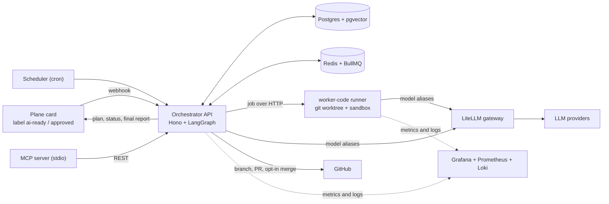

# Agent Platform

A self-hosted AI-agent platform that turns a labeled card into a reviewed GitHub pull request: planning, human approval, coding, validation, review and reporting, with governance built in.

[](LICENSE)
[](package.json)

Add the `ai-ready` label to a Plane card and the platform reads the repository context, posts a plan, waits for human approval (`approved` label), writes the change in an isolated worktree, validates it in a sandbox, fixes its own failures, has a critic role review the diff, opens a pull request and reports the result back on the card. Failures become per-repository lessons that are retrieved by semantic search in later runs.

## Capabilities

- **End-to-end delivery loop.** Plane webhook → plan → human approval → code generation with repository context → sandbox validation → critic review → pull request → optional auto-merge → final report on the card.
- **Role-based pipeline.** The `software-delivery-pipeline` agent exposes `planner`, `coder`, `critic`, `pr` and `reporter` roles on one LangGraph graph; `coder-agent` remains as a compatible key.
- **Self-correction.** Changes are validated before anything is pushed. When validation fails, the coder fixes and revalidates, up to `AGENT_MAX_FIX_ATTEMPTS` (default 3).
- **Review loop.** When the critic rejects or raises caveats, the coder addresses the review and the critic reviews again, up to `AGENT_MAX_REVIEW_ROUNDS` (default 3).
- **Lesson memory.** Failed validations and rejected reviews are distilled into lessons stored per repository and injected into future code generation. Retrieval is by relevance (local embeddings and pgvector cosine search), with a recency fallback.
- **Parallel runs.** Up to `AGENT_MAX_CONCURRENCY` runs at once (default 3), with a unique active-card index that prevents duplicate runs for the same card.
- **Agent and tool registries.** Versioned catalogs of agents (capabilities and roles) and tools (risk and scopes), available over REST and MCP. Each run records its `agent_id`.
- **Scheduler and runner failover.** Cron schedules create cards and runs; the orchestrator fails over between registered runners.
- **Artifact store.** Plan, patch, review, validation and summary of each run are stored durably and can be read through the API.
- **Opt-in auto-merge.** A pull request merges only when the card has the `auto-merge` label, tests pass and the critic approved.
- **Governance.** Redis-backed kill switch, cost guard per run and per 24 hours (defaults USD 2 and USD 20), approval policies, retries and persisted run state.
- **Observability.** Grafana dashboards for runs, cost and governance, and quality and memory; `/admin/*` endpoints; a read-only Mission Control view.
- **MCP server.** A stdio facade over the REST API for runs, lessons, agents, tools, concurrency and approvals, usable from Claude Code or any MCP client.

## Architecture



The run graph is `planning → (approval) → coding → reviewing → (revising → reviewing) → pr → merging → report`. A coder failure short-circuits to `report`. Agents and roles use model aliases (`cheap_fast`, `research`, `strong_coder`, `heavy_coder`, `critic`), so providers can change in the gateway without code changes.

Plane is the active card provider. Linear support is kept only for legacy data and migration, and its webhook is disabled unless explicitly configured.

## Tech stack

| Layer | Technology |
|---|---|
| API and orchestration | TypeScript, Node.js 22, Hono, LangGraph JS |
| Database and queue | Postgres with pgvector, Drizzle ORM, Redis, BullMQ |
| Vector memory | Local embeddings with Transformers.js (`all-MiniLM-L6-v2`, 384 dimensions, CPU) and pgvector |
| LLM gateway | LiteLLM with role-based model aliases |
| Code execution | `worker-code` runner with git worktrees, command allowlist and ephemeral Docker sandboxes |
| Integrations | Plane, GitHub, MCP (`apps/mcp-server`) |
| Observability | Grafana, Prometheus, Loki |
| Deployment | Docker Compose stacks per service; reference deployment on Proxmox with Tailscale for remote access |
| Tooling | pnpm workspaces, Biome, Vitest |

## Getting started

Prerequisites: Node.js 22 (see `.nvmrc`), pnpm through Corepack, and Postgres with pgvector, Redis and a LiteLLM gateway for a running system.

```bash
git clone https://github.com/raniellimontagna/agent-platform.git
cd agent-platform
corepack enable
pnpm install
pnpm build
pnpm test
```

Each app reads its configuration from environment variables. Start from `apps/orchestrator-api/.env.example` and `apps/worker-code/.env.example`; [docs/runbooks/secrets.md](docs/runbooks/secrets.md) lists every secret and how to rotate it.

```bash
pnpm --filter @agent-platform/orchestrator-api db:migrate   # apply database migrations
pnpm dev                                                     # run every app in watch mode
```

### Scripts

| Script | What it does |
|---|---|
| `pnpm build` | Builds every workspace package and app |
| `pnpm dev` | Runs every app in watch mode |
| `pnpm test` | Runs the Vitest suite |
| `pnpm typecheck` | Type-checks every workspace |
| `pnpm lint` / `pnpm lint:fix` | Biome checks |
| `pnpm eval` / `pnpm eval:regression` | Deterministic worker evals, with regression failure |
| `pnpm skills:sync` / `pnpm skills:check` | Syncs or checks the local agent skill registry |
| `pnpm verify` | Full gate: skills check, lint, build, tests, evals and eval regression |

### Self-hosting

The platform runs as four Docker Compose stacks under [`infra/compose/`](infra/compose): `gateway` (LiteLLM), `orchestrator` (API, Postgres with pgvector, Redis), `runners` (code execution) and `observability` (Grafana, Prometheus, Loki). Each stack has its own `.env.example`.

The reference deployment provisions one Proxmox container or VM per stack on an isolated network ([`infra/proxmox/`](infra/proxmox)) and deploys each service with `bash infra/deploy/deploy.sh <gateway|orchestrator|runners|observability>`. Plane webhooks reach the orchestrator through Tailscale Funnel. Step-by-step instructions and operational notes are in the [runbooks](docs/runbooks/README.md), starting with [proxmox-setup](docs/runbooks/proxmox-setup.md) and [webhook-tailscale](docs/runbooks/webhook-tailscale.md).

## Project structure

```text
agent-platform/
  apps/
    orchestrator-api/   # Hono API + LangGraph (webhooks, registries, vector memory, scheduler)
    worker-code/        # Code runner (worktrees, sandbox, validation, self-correction, evals)
    mcp-server/         # MCP stdio facade over the REST API
  packages/
    cards/              # Common card-provider abstraction
    graph/              # LangGraph state machine and role nodes
    llm/                # LiteLLM client and model aliases
    plane/              # Plane integration (active provider)
    linear/             # Linear integration (legacy and migration only)
    github/             # GitHub integration
    memory/             # Agent lesson memory
    policy/             # Approval and cost policies
  agent-skills/         # Reviewed prompt skills injected per agent key
  infra/
    compose/            # Docker Compose stack per service
    proxmox/            # Provisioning scripts for the reference deployment
    deploy/             # Deploy scripts
  docs/
    decisions/          # ADRs and agent flow
    runbooks/           # Operator guides
```

## Documentation

Most documentation is written in Portuguese.

- [Documentation map](docs/README.md): what is current and what is historical.
- [Current state](docs/CURRENT.md): active flow, ownership boundaries and verification gate.
- [Architecture](docs/ARCHITECTURE.md): deployment topology, end-to-end flow and component map.
- [Agent workflow](docs/decisions/FLOW-agent-workflow.md): detailed agent flow.
- [Runbooks index](docs/runbooks/README.md): operator tasks, including:
  - [proxmox-setup](docs/runbooks/proxmox-setup.md): provisioning the reference deployment
  - [webhook-tailscale](docs/runbooks/webhook-tailscale.md): exposing the Plane webhook; Linear compatibility stays disabled by default
  - [grafana-lan-access](docs/runbooks/grafana-lan-access.md): reaching Grafana from the local network
  - [litellm-guardrails](docs/runbooks/litellm-guardrails.md): gateway budgets and rate limits
  - [secrets](docs/runbooks/secrets.md): secret inventory and rotation

Architecture decisions:

- [ADR-0001](docs/decisions/ADR-0001-stack-typescript-hono-drizzle.md): TypeScript, Hono and Drizzle stack
- [ADR-0002](docs/decisions/ADR-0002-infra-proxmox-4-vms.md): Proxmox infrastructure with four VMs
- [ADR-0003](docs/decisions/ADR-0003-llm-gateway-litellm-model-aliases.md): LiteLLM gateway and model aliases
- [ADR-0004](docs/decisions/ADR-0004-security-tailscale-env-human-approval.md): security, Tailscale and human approval
- [ADR-0005](docs/decisions/ADR-0005-linear-github-agent-workflow.md): Linear and GitHub workflow (historical; Plane is current)
- [ADR-0006](docs/decisions/ADR-0006-llm-via-omniroute-oauth.md): LLM access through OmniRoute (OAuth)

## License

Released under the [MIT License](LICENSE).
